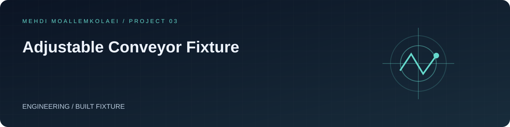

# Adjustable Conveyor Fixture

**Change conveyor length and examine its effect on sorting timing.**

Fixture design · CAD · Mechanical assembly · Timing

[Overview](#overview) · [Design](portfolio/DESIGN.md) · [Setup](portfolio/SETUP.md) · [Validation](portfolio/VALIDATION.md) · [Evidence](portfolio/EVIDENCE.md)

<!-- project-navigation:start -->

  
  
  
  

<strong>Built fixture</strong> &nbsp; / &nbsp; Engineering &nbsp; / &nbsp; <a href="https://ace-alch.github.io/">Mehdi's portfolio</a>

<!-- project-navigation:end -->

## Overview

| Item | Record |
| :-- | :-- |
| Project type | Built fixture |
| Field | Engineering |
| Material in this package | Documentation package; original source not included |
| Documentation review | 17 November 2026 |

## Scope

Change conveyor length and examine its effect on sorting timing. The documentation separates the stated project scope, inspected artifacts and future work. A listed feature is not a new test result.

### Main elements

- Length adjustment
- Sensor location
- Travel distance
- Sorting timing

## Explore the project

| Design | Setup | Validation | Evidence |
| :-- | :-- | :-- | :-- |
| [System and boundaries](portfolio/DESIGN.md) | [Available entry points](portfolio/SETUP.md) | [Test plan](portfolio/VALIDATION.md) | [Verified material](portfolio/EVIDENCE.md) |

## Source status

This package contains project documentation and visual assets. Original code, CAD, data and test records have not been added. The setup record lists the files needed for a reproducible release.

## Next work

- [ ] Dimensioned drawings
- [ ] Adjustment limits
- [ ] Calibration method
- [ ] Timing measurements

## Credits and reuse

Project record: Mehdi Moallemkolaei. Specific third-party and course contributions must retain their original notices.

Existing license terms remain in effect. This package does not grant a new license over source code, course material, models or datasets. See [reuse and contribution notes](portfolio/CONTRIBUTIONS.md).
